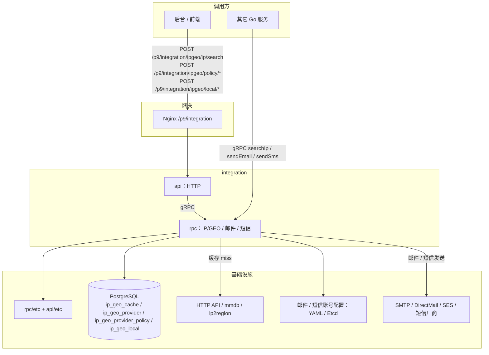

# integration

P9 **第三方接入服务**：短信、邮件、第三方客服、IP/GEO 等外部能力统一接入。当前已落地 **IP/GEO、邮件和短信**。HTTP 管理路径 `/p9/integration/...`，需登录；邮件和短信当前通过内部 gRPC 调用。

- HTTP：[API.md](API.md)
- gRPC：[RPC.md](RPC.md)
- 邮件调用：[SendEmail](RPC.md#sendemail)；实测：[EMAIL_TESTING.md](EMAIL_TESTING.md)
- 短信调用：[SendSms](RPC.md#sendsms)
- 配置与启动：[OPS.md](OPS.md)
- 仓库索引：[../README.md](../README.md)

---

## 代码分层（当前）

```text
api/                          # HTTP：鉴权 + 转调 RPC（不直连业务库）
rpc/
  service/                    # 业务层根：Deps 聚合各域
    ipgeo/                    # IP/GEO 域 CRUD（LocalIP / 策略）
    message/                  # 消息域：邮件、短信业务入口
  internal/
    svc/                      # 依赖注入：开库、缓存、组装 Deps + Lookup
    logic/                    # 薄 logic：PB <-> 领域、调用域服务或 Lookup
    ipgeo/                    # 查询引擎：lookup / source / cache / geo
    message/email/            # 邮件校验、MIME、通道、重试和 Etcd 配置
    message/sms/              # 号码校验、短信通道、加权路由和 Etcd 配置
    db/                       # 开库与 migrate
  ent/                        # 表模型（当前与各域共用一套库）
```

调用约定：

| 能力 | 入口 |
| --- | --- |
| 管理 CRUD（本地 IP、策略） | `logic` → `Deps.IpGeo` → `ent` |
| IP 查询 Search | `logic` → `IpGeo.Lookup` → 缓存 / 各驱动 |
| 邮件 SendEmail | `logic/message` → `Deps.Message` → `message/email` → SMTP / 阿里云 / AWS |
| 短信 SendSms | `logic/message` → `Deps.Message` → `message/sms` → 短信厂商 |

当前 RPC 启动仍需要 PostgreSQL（`DB.DSN`），IP/GEO 使用现有 Ent 表。邮件和短信没有新增业务表，也不把正文另存 Redis 或 PostgreSQL；邮件近期投递记录保存在进程内存，短信逐号码结果在响应中返回。

---

## 在系统中的位置



查询顺序：合法公网按租户策略选出启用源 → 每个源先查缓存（KV，键 `name|IP`）→ miss 再 Fetch。默认驱动 `table` 落 `ip_geo_cache`；`CacheDriver: redis` 走 `CacheRedis`。`Driver=local` 查本地表 `ip_geo_local`（后台 `/local/*` 维护）。在线源用通用 `http` 驱动。离线库用 `mmdb`、`ip2region`。服务商连接配置无管理接口；策略走 `/policy/*`。

| 场景 | 入口 |
| --- | --- |
| 后台查 IP | [`POST /p9/integration/ipgeo/ip/search`](API.md#post-p9integrationipgeoipsearch) |
| 后台管策略 | [`/p9/integration/ipgeo/policy/*`](API.md#策略) |
| 后台管本地 IP | [`/p9/integration/ipgeo/local/*`](API.md#本地-ip-表) |
| 其它服务 | [gRPC `SearchIp`](RPC.md#searchip) |
| 其它服务发邮件 | [gRPC `sendEmail`](RPC.md#sendemail)，SMTP / 阿里云 DirectMail / AWS SES |
| 其它服务发短信 | [gRPC `sendSms`](RPC.md#sendsms)，指定厂商或按权重路由 |

消息能力分别由 `Message.Email.Enabled` 和 `Message.SMS.Enabled` 控制，通道账号可由 YAML 或 Etcd 提供。只启动同一个 RPC 进程即可；账号开通、通道支持范围及实测要求见对应文档。返回的 `accepted` 是厂商接受数量，不代表最终送达；超时或结果不确定时应先核实，避免重复发送。

yaml `DB.DSN` **必填**。启动连库并建表；服务商表为空时写入 yaml `IpGeo.Providers`。已有数据不覆盖；改 yaml 后需清空该表再重启才会重新种子。

配置与部署步骤见 [OPS.md](OPS.md)。其他服务使用部署环境提供的 RPC 地址接入，调用字段和示例见 [RPC.md](RPC.md)。

---

## 调用关系

| 上游 | 方式 |
| --- | --- |
| 后台 | HTTP `/p9/integration/ipgeo/ip/search`、`/p9/integration/ipgeo/policy/*`、`/p9/integration/ipgeo/local/*` |
| 业务进程 | gRPC `Integration` |

| 下游 | 用途 |
| --- | --- |
| PostgreSQL | `ip_geo_cache` / `ip_geo_provider` / `ip_geo_provider_policy` / `ip_geo_local` |
| HTTP JSON API | `driver=http`，如 MaxMind / ip-api |
| GeoLite2 `.mmdb` | `driver=mmdb` |
| ip2region `.xdb` | `driver=ip2region` |
| SMTP / 阿里云 DirectMail / AWS SES | 邮件发送，按请求特性和通道优先级选择 |
| BytePlus / Submail / Gotone / AWS SNS / 阿里云国际短信 | 短信发送，指定通道或加权路由 |
| Etcd（可选） | 邮件和短信通道配置读取、热更新；与 RPC 服务发现配置独立 |
