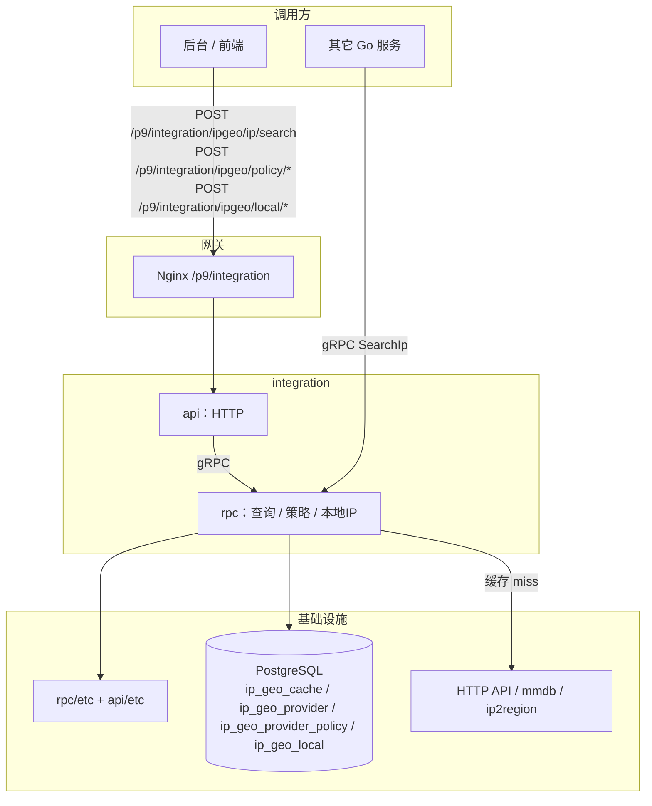

# integration

P9 **第三方接入服务**：短信、邮件、第三方客服、IP/GEO 等外部能力统一接入。当前已落地 **IP/GEO**。HTTP 管理路径 `/p9/integration/...`，需登录。

- HTTP：[API.md](API.md)
- gRPC：[RPC.md](RPC.md)
- 配置与启动：[OPS.md](OPS.md)
- 仓库索引：[../README.md](../README.md)

---

## 代码分层（当前）

```text
api/                          # HTTP：鉴权 + 转调 RPC（不直连业务库）
rpc/
  service/                    # 业务层根：Deps 聚合各域
    ipgeo/                    # IP/GEO 域 CRUD（LocalIP / 策略）
    # message/                # 示例：后续消息域
  internal/
    svc/                      # 依赖注入：开库、缓存、组装 Deps + Lookup
    logic/                    # 薄 logic：PB <-> 领域、调 Deps.IpGeo 或 Lookup
    ipgeo/                    # 查询引擎：lookup / source / cache / geo
    db/                       # 开库与 migrate
  ent/                        # 表模型（当前与各域共用一套库）
```

调用约定：

| 能力 | 入口 |
| --- | --- |
| 管理 CRUD（本地 IP、策略） | `logic` → `Deps.IpGeo` → `ent` |
| IP 查询 Search | `logic` → `IpGeo.Lookup` → 缓存 / 各驱动 |

当前 **全服务共用一套 PostgreSQL**（`DB.DSN`）。后续若消息等业务分库：在 `svc` 打开多 DSN，往 `Deps` 增加 `Message` 等域服务即可。

---

## 在系统中的位置



查询顺序：合法公网按租户策略选出启用源 → 每个源先查缓存（KV，键 `name|IP`）→ miss 再 Fetch。默认驱动 `table` 落 `ip_geo_cache`；`CacheDriver: redis` 走 `CacheRedis`。`Driver=local` 查本地表 `ip_geo_local`（后台 `/local/*` 维护）。在线源用通用 `http` 驱动。离线库用 `mmdb`、`ip2region`。服务商连接配置无管理接口；策略走 `/policy/*`。

| 场景 | 入口 |
| --- | --- |
| 后台查 IP | [`POST /p9/integration/ipgeo/ip/search`](API.md#post-p9integrationipgeoipsearch) |
| 后台管策略 | [`/p9/integration/ipgeo/policy/*`](API.md#策略) |
| 后台管本地 IP | [`/p9/integration/ipgeo/local/*`](API.md#本地-ip-表) |
| 其它服务 | [gRPC `SearchIp`](RPC.md#searchip) |

yaml `DB.DSN` **必填**。启动连库并建表；服务商表为空时写入 yaml `IpGeo.Providers`。已有数据不覆盖；改 yaml 后需清空该表再重启才会重新种子。

快速启动：

```powershell
cd integration
go run ./rpc
go run ./api
```

完整步骤见 [OPS.md](OPS.md#本地开发)。

---

## 调用关系

| 上游 | 方式 |
| --- | --- |
| 后台 | HTTP `/p9/integration/ipgeo/ip/search`、`/p9/integration/ipgeo/policy/*`、`/p9/integration/ipgeo/local/*` |
| 业务进程 | gRPC `Integration` |

| 下游 | 用途 |
| --- | --- |
| PostgreSQL | `ip_geo_cache` / `ip_geo_provider` / `ip_geo_provider_policy` / `ip_geo_local` |
| HTTP JSON API | `driver=http`，如 MaxMind / ip-api |
| GeoLite2 `.mmdb` | `driver=mmdb` |
| ip2region `.xdb` | `driver=ip2region` |
