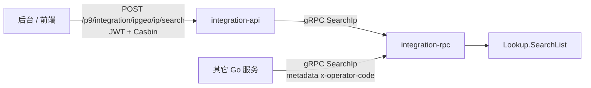
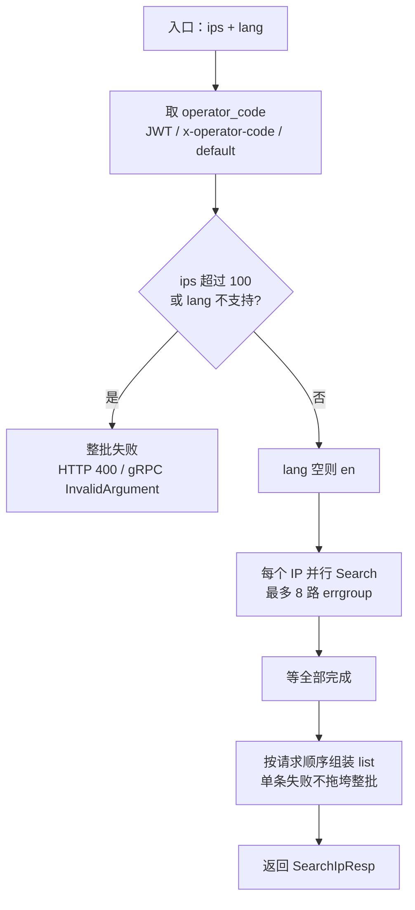
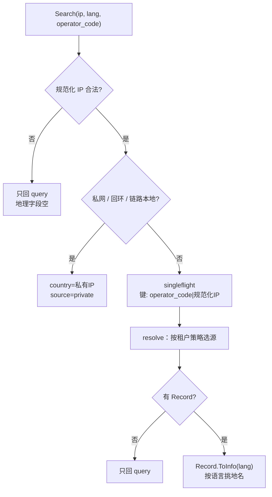
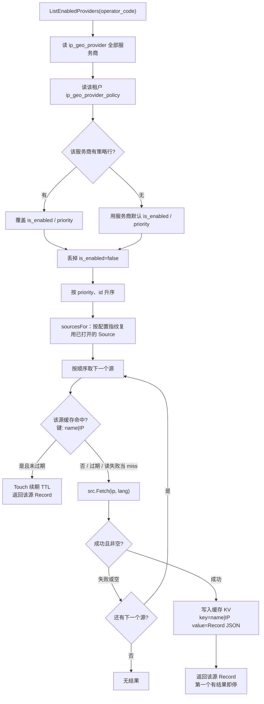
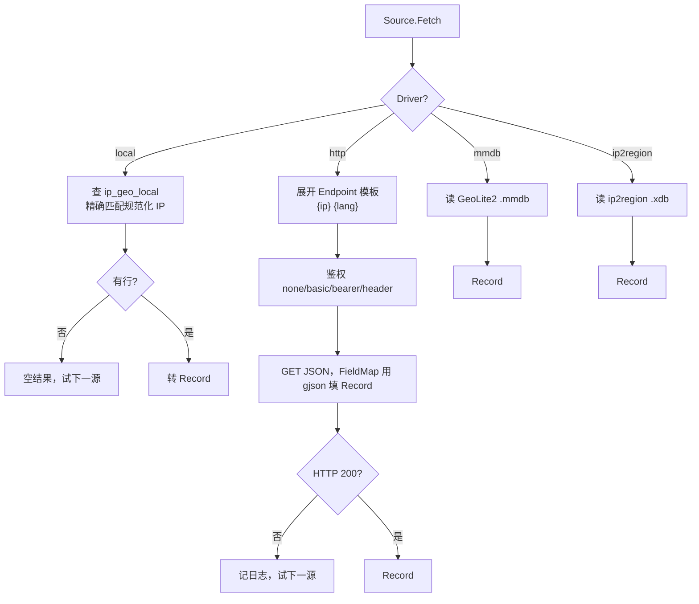
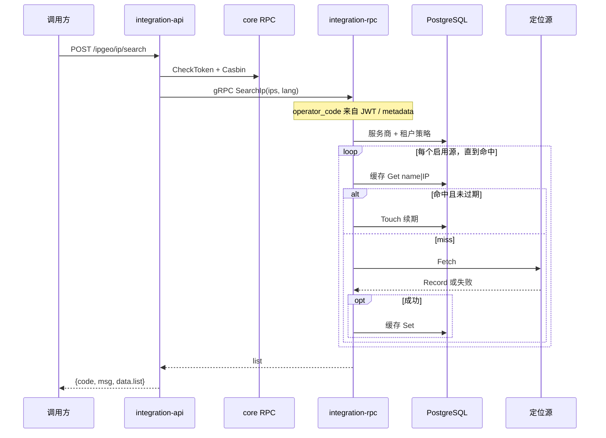

# IP 查询流程图

接口：`POST /p9/integration/ipgeo/ip/search`

HTTP 对接见 [API.md](API.md#post-p9integrationipgeoipsearch)。其它服务 gRPC 见 [RPC.md](RPC.md#searchip)。

`/ip/search` **不按请求体选源**。租户来自登录 JWT 的 `operator_code`（其它服务走 gRPC metadata `x-operator-code`），再用该租户的策略决定查哪些源、先查谁。

缓存是 **KV**：键 `name|规范化IP`（例如 `maxmind|8.8.8.8`），值是整包 `Record` JSON。默认 `ip_geo_cache`（列 `ip` + `payload`）；yaml `IpGeo.CacheDriver` 可换成 `memory` 或 `redis`（`CacheRedis`）。同一 IP 不同源各一条。策略换源后去读新源的键，没有再 Fetch 并写回。停用某源就不会再碰它的缓存。

## 选源规则

1. 拉全部服务商（yaml 种子写入的 `ip_geo_provider`）
2. 有该租户在 `ip_geo_provider_policy` 的行，就覆盖 `is_enabled` / `priority`；没有就用服务商默认
3. 丢掉未启用的
4. 按有效 `priority` 从小到大（相同再按 `id`）依次：先读该源缓存（键 `name|IP`），miss 再 Fetch；**第一个有结果的就停**

默认种子一般是：`local`(0) → `maxmind`(1) → `geoip-city`(2) → `ip2region`(3)。改 `/policy/save` 只影响当前租户的启用和顺序，不必清全表缓存。

单条失败不影响整批：其它 IP 仍会 200 返回。

---

## 1. 调用入口

HTTP 路径：`Jwt` → `ActionLog` → `Authority` → `SearchIpHandler` → API Logic 转调 RPC。API 不直连业务库。

RPC 路径：`SearchIpLogic` 用 `AccountOperatorCode(ctx)` 取租户，再调 `Lookup.SearchList`。

---

## 2. 批量查询主流程

约束：

| 项 | 规则 |
| --- | --- |
| 批量上限 | 最多 100 个 IP，超限整批失败 |
| 并发 | `errgroup` 上限 8 |
| 语言 | 空则 `en`；仅 `en` `zh-CN` `pt-BR` `ru` `fr` `ja` `es` `de` |
| 租户 | 忽略请求体；空则 `default` |
| 回源合并 | 同租户同规范化 IP 走 `singleflight` |

---

## 3. 单 IP 查询

---

## 4. 选源 + 缓存 + Fetch

缓存驱动（yaml `IpGeo.CacheDriver`）：

| 驱动 | 存储 |
| --- | --- |
| `table`（默认） | PostgreSQL `ip_geo_cache`，主键即缓存键 |
| `memory` | 进程内 map |
| `redis` | `CacheRedis`，Get 用 PTTL 回填过期 |

`CacheTTL` 单位小时；`0` 表示不过期。命中且配置了 TTL 时 `Touch` 续期。缓存 miss 或读失败都当未命中，继续 Fetch。

---

## 5. 各源 Fetch

默认种子顺序（表空时由 yaml `IpGeo.Providers` 写入，已有数据不覆盖）：

| 优先级 | name | driver | 说明 |
| --- | --- | --- | --- |
| 0 | `local` | `local` | 后台 `/local/*` 维护的本地表 |
| 1 | `maxmind` | `http` | MaxMind Country Web API |
| 2 | `geoip-city` | `mmdb` | 默认未启用 |
| 3 | `ip2region` | `ip2region` | 离线省市库 |

---

## 6. 时序（HTTP 查询）

其它服务直连 gRPC 时跳过 API / Casbin，租户走 `x-operator-code`。

---

## 代码位置

| 环节 | 文件 |
| --- | --- |
| HTTP 路由 / 鉴权 | `api/internal/handler/routes.go` |
| HTTP 转 RPC | `api/internal/logic/ipgeo/search_ip_logic.go` |
| RPC 入口 | `rpc/internal/logic/ipgeo/search_ip_logic.go` |
| 批量 / 单 IP / 缓存编排 | `rpc/internal/ipgeo/lookup/lookup.go` |
| 租户策略叠加 | `rpc/service/ipgeo/provider.go`、`overlay.go` |
| 驱动构造 | `rpc/internal/ipgeo/source/build.go` |
| 缓存 KV | `rpc/internal/ipgeo/cache/` |
