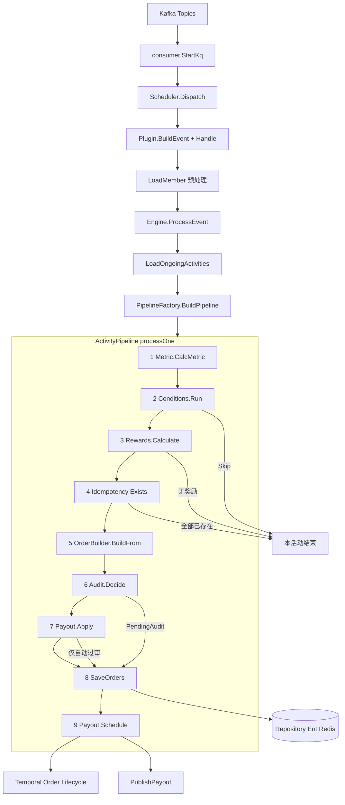
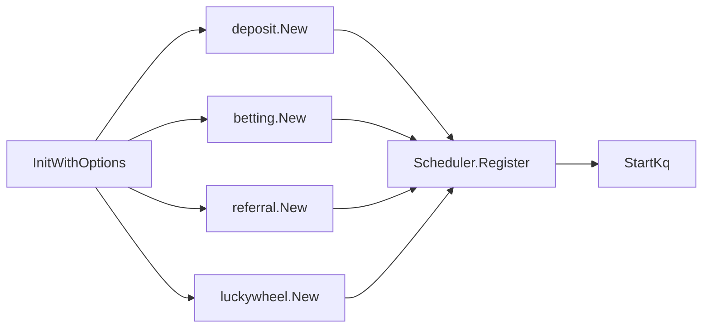
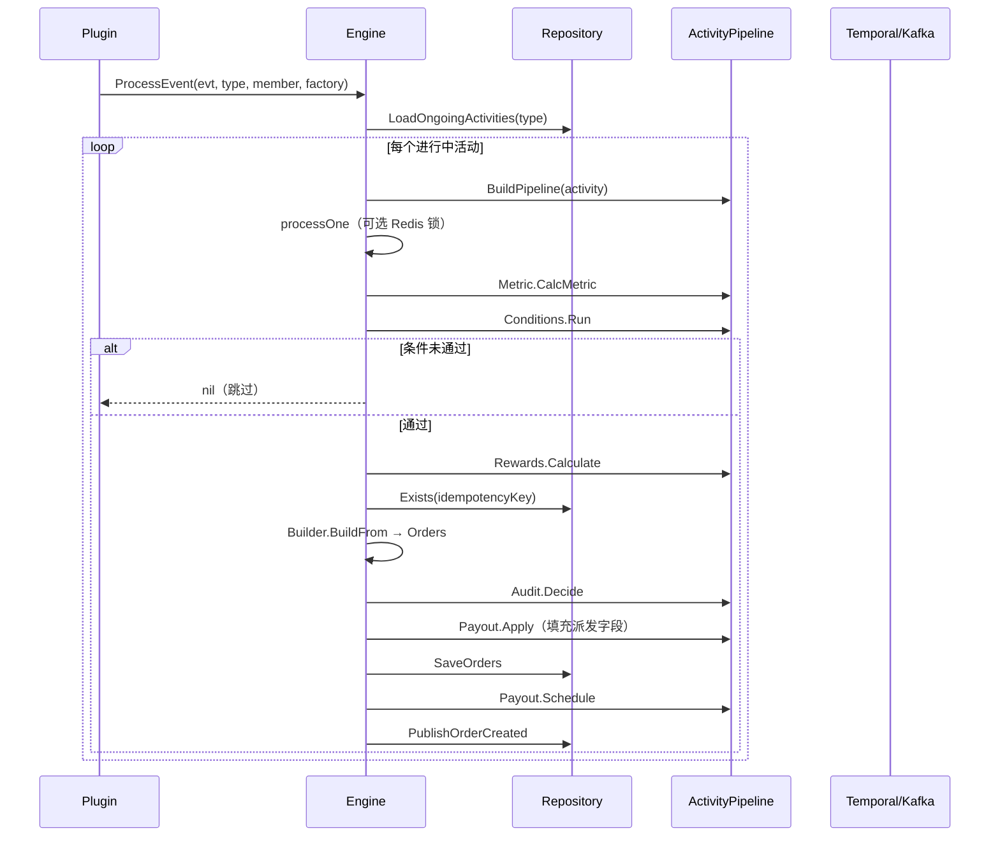

# 活动引擎详细流程

- **适用服务：** `operator-activity`
- **代码主目录：** `modules/activity/`
- **更新日期：** 2026-11-12

本文描述厅侧活动**运行时发奖引擎**的端到端流程：Kafka 事件进入 → 插件预处理 → Engine 评估/建单 → 审核与派发 → Temporal / 消息出站。  
后台 CRUD（创建/编辑/发布/关闭）见 admin-api 对接文档，本文不展开。

---

## 一、整体架构

入站调度与 **Engine 内 Pipeline** 分层如下：Plugin 按活动配置 `BuildPipeline`，Engine 对每个进行中活动顺序执行流水线各段。



Pipeline 各段职责：

| 顺序 | 段 | 接口 / 实现 | 作用 |
|---|---|---|---|
| 1 | Metric | `metric.Calculator` | 算触发指标（充值笔数/金额、有效投注等） |
| 2 | Conditions | `condition.Chain` | 责任链校验状态/时间/层级/周期/参与与领取限制等 |
| 3 | Rewards | `reward.Calculator` | 按奖金模式与阶梯匹配 `RewardItem` |
| 4 | Idempotency | `repo.Exists` | 按幂等键过滤已发奖励 |
| 5 | OrderBuilder | `pipeline.Builder` | 组装 `ActivityOrder` |
| 6 | Audit | `audit.Strategy` | 自动过审或待人工审 |
| 7 | Payout.Apply | `payout.Strategy` | 填充 `PayoutAt` / `ClaimExp` / 状态（无副作用） |
| 8 | SaveOrders | Repository | 事务落库 |
| 9 | Payout.Schedule | `payout.Strategy` | Temporal / 即时 `PublishPayout` |

> 注：`Repository.PublishOrderCreated` 当前为空实现；真正出站派发走 `PublishPayout`。条件未过、无奖励或幂等全命中时，后续段不执行。

| 组件 | 路径 | 职责 |
|---|---|---|
| Runtime | `modules/activity/runtime.go` | 组装 Repo、Engine、Scheduler、各插件与 PipelineFactory |
| Scheduler | `modules/activity/scheduler.go` | 按插件名 `BuildEvent` → `Handle`；统一 WrapHandler / 错误分类 |
| Engine | `modules/activity/engine.go` | 加载进行中活动，驱动上表 Pipeline 全流程 |
| Plugin | `modules/activity/plugin/*` | 解析 Kafka、补全会员，并实现 `BuildPipeline` 组装各段策略 |
| Pipeline | `modules/activity/pipeline/*` | Metric / Condition / Reward / Audit / Payout / Order Builder |
| Consumer | `modules/activity/consumer/` | 每插件独立 Kafka Group 消费并投递 Scheduler |
| Repository | `modules/activity/repository/` | 活动缓存、订单、幂等、锁、Kafka 发布 |
| Worker | `modules/worker/order/` | Temporal 订单生命周期（领取过期、延迟派发等） |

**当前已接入引擎的活动类型（有 Plugin）：**

| 值 | 常量 | 插件 |
|---|---|---|
| 1 | `ActivityTypeDeposit` | `plugin/deposit` |
| 2 | `ActivityTypeWagering` | `plugin/betting`（包名历史保留） |
| 3 | `ActivityTypeReferralMember` | `plugin/referral`（奖励归属**邀请人**） |
| 4 | `ActivityTypeLuckyWheel` | `plugin/luckywheel`（Kafka 送机会；`Spin` 建单**不**走 `Engine.ProcessEvent`） |

类型 5～14（助力、盲盒、签到等）仅在枚举/表单层定义，**尚无 Runtime Plugin**。

---

## 二、初始化与注册

入口：`promotion.Init` / `InitWithOptions`（`runtime.go`）。

1. `repository.New(DB, brokers...)` 创建仓储（可选 Kafka 生产者）。
2. 若配置了 Redis：启用充值窗口计数器 + 用户-活动分布式锁（`UserPromoLocker`）。
3. `NewEngine(repo, locker)`。
4. 创建四类插件并 `Scheduler.Register`。
5. `pipelines` map：`ActivityType → PipelineFactory`（审核通过时按类型取流水线）。
6. `consumer.StartKq(sched, brokers)`：按 `PluginKq` 为每个插件启独立消费者。



---

## 三、Kafka 消费 → 插件调度

### 1. Topic / Group（节选）

配置见 `consumer/kq_conf.go`：

| 插件 | Topic（示例） | Group |
|---|---|---|
| deposit | `GameUserDepositOrderApproved` | `activity-engine.deposit` |
| betting | `GameUserGameOrderSettled` | `activity-engine.betting` |
| referral | 注册 / 充值审核 / 注单结算（多 Topic 同 Group） | `activity-engine.referral` |
| luckywheel | 充值 / 注单结算等（送抽奖机会） | `activity-engine.luckywheel` |

各插件**独立 Group**，同 Topic 多插件可并行消费，不保证跨插件进程内顺序。

### 2. 消费循环

`StartKq` 回调：

1. `xkafka.DecodePayload` → `types.Payload`
2. `Scheduler.Dispatch(ctx, pluginName, payload)`
3. 永久错误（`perr.IsPermanent`）→ 跳过并提交；可重试错误 → 返回 err 触发重投

### 3. Scheduler.Dispatch

```
BuildEvent(payload) → Event
  ├─ Event == nil 或 OperatorCode 空 → 跳过
  └─ ctx 注入 OperatorCode → Plugin.Handle(evt)
```

`WrapHandler` 捕获 panic，并按 `perr` 分类错误。

---

## 四、插件层（以充值为例）

路径：`plugin/deposit/`

### 1. BuildEvent

- 仅处理 `topic.GameUserDepositOrderApproved`
- 反序列化 `DepositPayload` → `types.Event`（`EventDepositApproved`、金额、订单号、会员等）

### 2. Handle

```
Service.Process(evt)
  ├─ validateDepositEvent（member/order/amount）
  ├─ MemberLookup.LoadMember
  └─ 补全 ClientType / OperatorCode
→ Engine.ProcessEvent(ctx, evt, ActivityTypeDeposit, memberInfo, deposit.Service)
```

洗码 / 推荐插件结构相同：预处理后调用 `Engine.ProcessEvent`，并传入各自 `Service` 作为 `PipelineFactory`。

### 3. BuildPipeline（充值）

`deposit.Service.BuildPipeline`：

| 段 | 实现 |
|---|---|
| Metric | `metric.DepositCalculator`（周期窗口 + 可选 Redis 计数） |
| Conditions | `condition.BuildBaseChain` + `DepositTypeCondition` |
| Rewards | `reward.BuildFromSettings` |
| Audit | `audit.BuildFromSettings` |
| Payout | `payout.BuildFromSettings`（含 Temporal Starter） |

---

## 五、Engine 主流程（核心）

入口：`Engine.ProcessEvent` → 对每个进行中活动 `processOne`。



### 步骤说明

| 步骤 | 行为 | 失败策略（概要） |
|---|---|---|
| 1. 加载活动 | `LoadOngoingActivities(activityType)`，仅 **Ongoing** | 可重试 |
| 2. 用户锁 | `locker.Lock(activityID, memberID)`（可选） | 可重试 |
| 3. Metric | `pipe.Metric().CalcMetric` → `EvalContext.Metric` | 可重试 |
| 4. Condition | `pipe.Conditions().Run`；Skip → 本活动结束 | Error → 可重试 |
| 5. Reward | `Calculate`；空或金额≤0 → 跳过 | 计算失败多为永久 |
| 6. 幂等 | `repo.Exists(IdempotencyKey)`，已存在则过滤 | 可重试 |
| 7. 建单 | `pipeline.Builder.BuildFrom` | — |
| 8. 审核 | `Audit.Decide`：自动过审 / 待人工审 | — |
| 9. 派发字段 | 自动过审：`Payout.Apply` 写 `PayoutAt`/`ClaimExp`/状态 | — |
| 10. 落库 | `SaveOrders` | Classify |
| 11. 调度 | 非待审订单：`Payout.Schedule`（即时发布或 Temporal） | 可重试 |
| 12. 出站 | `PublishOrderCreated` | 可重试 |

任一活动 `processOne` 失败会**立即返回**，由上层按 `perr` 决定重试或跳过。

### 人工审核

- `Engine.ApproveOrder`：待审 → Approved → `Payout.Apply` → 更新库 → `Schedule`
- `Engine.RejectOrder`：待审 → Rejected

审核通过时通过 `Runtime.PipelineFactory(type)` 取对应插件流水线。

---

## 六、条件责任链（公共）

`condition.BuildBaseChain` 顺序：

1. `ActivityStatusCondition` — 必须进行中  
2. `ActivityTimeCondition` — 开放/结束时间  
3. `FixedLevelCondition` / `AutoLevelCondition` — 层级白名单  
4. `ClientTypeCondition` — 客户端  
5. `CycleModeCondition` — 循环周期窗口  
6. `ApplyLimitCondition` — 参与限制（设备/IP 等）  
7. `ApplyModeCondition` — 自动/手动参与（是否已报名）  
8. `ClaimLimitCondition` — 领取前置（充值/绑卡/短信等）  

业务插件再追加专属条件（如充值的 `DepositTypeCondition`）。

`Chain.Run`：任一节点 `Skip` / `Error` 短路；全部通过为 `Pass`。

---

## 七、奖励、审核与派发

### 奖励

`reward.BuildFromSettings` 按 `ActivitySettings`（奖金模式、阶梯 schema、推荐/转盘配置等）生成 `RewardItem`（含金额与幂等键）。

### 审核

`audit.BuildFromSettings`：结合活动 `AutoAudit` / `AutoAuditMaxAmt` 等决定：

- `DecisionAutoPass` → 订单 `Approved`，再走派发 Apply  
- 否则 → `PendingAudit`，不 Schedule

### 派发策略（`pipeline/payout`）

| 模式 | 含义 |
|---|---|
| 手动领取 + 过期作废 / 过期自动领 | 设置 `ClaimExp`，状态进入待领取等 |
| 自动派发 | `PayoutAt` 由 Realtime / NextDay Timing 计算 |

`Schedule`：

- `PayoutAt` 在未来 → `SaveSchedule` + Temporal `StartOrderLifecycle`  
- 已到期 → 直接 `PublishPayout`，并可启短生命周期工作流  

引擎**不**直接改会员钱包；派发消息由账务等下游消费。

---

## 八、幸运转盘特殊路径

与「事件→ProcessEvent→建奖励单」不同，转盘分两段：

1. **Kafka 达标事件**（充值/投注）：`Handle` → `GrantChances`，达标后**增加抽奖机会**（不调用 `Engine.ProcessEvent`，一般不直接发奖金单）。送机会条件链通常去掉 `claim_limit`。  
2. **会员主动 Spin**（`luckywheel.Service.Spin`）：扣机会 → 按奖池权重抽奖 → 复用 Audit/Payout **在 Service 内建单**（仍不经过 `Engine.ProcessEvent`）。

因此转盘既吃 Kafka，也提供 RPC/API 入口抽奖；现金奖励单主要来自 Spin。

---

## 九、活动与订单状态

### 活动状态（后台）

| 值 | 含义 | 引擎 |
|---|---|---|
| Draft=1 | 草稿 | 不加载 |
| Ongoing=2 | 进行中 | `LoadOngoingActivities` 唯一目标 |
| Closed=3 | 已结束 | 不加载 |

发布/关闭走 admin 仓储，并失效进行中活动缓存。

### 订单状态（节选）

见 `types.OrderStatus`：待审核 → 通过/拒绝 → 待领取/已领取/过期 → 待派发/已派发 → 风控等。  
引擎建单时主要写入：`PendingAudit` 或经 Apply 后的 `Approved` / `PendingPayout` / 待领取等。

---

## 十、关键数据结构

| 类型 | 说明 |
|---|---|
| `types.Payload` | Kafka 统一信封（Name/Data/Timestamp） |
| `types.Event` | 引擎输入：会员、金额、订单号、事件类型、厅编码等 |
| `types.MemberInfo` | 层级、客户端、厅编码等 |
| `types.Activity` | 运行时活动配置（含解析后的 Settings） |
| `types.RewardItem` | 匹配到的奖励项 + 幂等键 |
| `types.ActivityOrder` | 奖励订单（主单 + items） |
| `pipeline.EvalContext` | 评估上下文：Activity/Event/Member/Metric/Round/StepLog |
| `plugin.ActivityPipeline` | Metric + Conditions + Rewards + Audit + Payout |

---

## 十一、错误与可观测性

- `modules/activity/perr`：`Retryable` / `Permanent`；消费端永久错误跳过，可重试返回 err。  
- `pipeline.StepLogger`：metric / condition / reward / idempotency / audit / payout / save_orders 分步日志，`Flush` 汇总。  

---

## 十二、与 README 旧图的差异

根目录 `README.md` 中「事件处理流程」为早期示意（任务进度/完成事实）。**当前实现**以本文为准：插件 Pipeline + Engine 建奖励订单，无独立「任务进度」主路径。

---

## 十三、扩展新活动类型（5～14）

1. 在 `types/enums.go` 已有类型值。  
2. 新增 `plugin/<name>`：实现 `Plugin` + `PipelineFactory`（Metric/条件/奖励）。  
3. `runtime.Init` 中 `Register` 并写入 `pipelines` map。  
4. `consumer/kq_conf.go` 配置 Topic/Group。  
5. 若需会员主动操作（类似 Spin），另暴露 RPC 入口。  

未完成以上步骤前，后台可创建草稿配置，但**不会有运行时发奖**。

---

## 十四、实现现状与已知缺口

对照代码阅读，流程上需注意：

| 项 | 现状 |
|---|---|
| 周期金额/笔数指标 | `SumDeposits` / `SumBets` / `CountBets` 等多为 TODO，返回 `0`；累计类活动指标可能不准（充值窗口可走 Redis `DepositWindowCounter`） |
| `ApplyLimit` / `ClaimLimit` | 条件节点已挂链，部分真实计数逻辑未完全接通，配置非空时也可能近似 Pass |
| `PublishOrderCreated` | Repo 层空实现；`KafkaPublisher` 有对应方法但未接到 Repo |
| Temporal Worker | 进程注册 `order`（+ schedule demo）；`modules/worker/settlement` 收款结算 demo **未**挂入 `worker.Init` |
| 评估上下文 | 无 `ProcessContext` 命名；统一为 `pipeline.EvalContext` |
| 会员加载 | 由插件 `LoadMember` 完成；引擎内自查已注释，依赖插件传入非 nil `memberInfo`（加锁也依赖此） |

以上缺口不影响「架构主路径」理解，但联调累计奖励 / 出站通知 / 结算时需单独核对。
