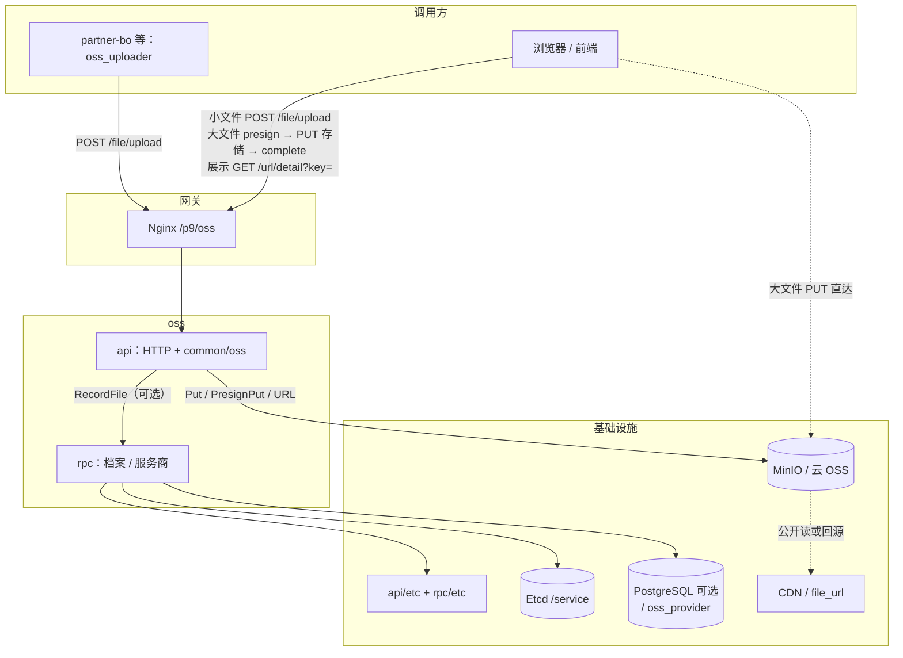

# oss

P9 **对象存储服务**：HTTP 上传直连 `common/oss`（换驱动不改 HTTP），可选 RPC + PostgreSQL 做文件档案与服务商。未配 `oss_rpc` 时只存对象、不写档案。对外路径前缀 `/p9/oss`。

> 业务表存 `key`。即时展示用返回的 `url`；换链 `GET /url/detail?key=`。列表里的公开图按 `path_style` 本地拼，不要逐条换链。服务端导出走本服务 HTTP（`oss_uploader`）才会写入档案。

- HTTP 接口（参数 / 返回值）：`[docs/API.md](docs/API.md)`
- 其它服务 gRPC：`[docs/RPC.md](docs/RPC.md)`
- 配置、本地启动、部署、排错：`[docs/OPS.md](docs/OPS.md)`
- 存储驱动：`[common/oss/README.md](common/oss/README.md)`

---

## 在系统中的位置




业务进程经本服务 HTTP 上传。建桶 / ACL / CDN 由运维配置。未配 `oss_rpc.endpoints` 时不写档案、不用服务商接口。


| 场景                     | 入口                                                      | 档案 `t_oss_file`     |
| ---------------------- | ------------------------------------------------------- | ------------------- |
| 浏览器小文件（默认 ≤ 32MB）      | `[POST /file/upload](docs/API.md#post-p9ossfileupload)` | 成功即写入（已配库）          |
| 浏览器大文件（默认 ≤ 2GB）       | [预签名三步](docs/API.md#预签名直传)                              | **complete 成功后**才写入 |
| 服务端导出 CSV 等            | `oss_uploader` → `POST /file/upload`                    | 与小文件相同              |
| 进程内直连 `common/oss.Put` | 其它 Go 服务可直接用本包                                          | **不入库**             |


配置优先级：**库默认服务商 > etcd** `${ETCD_CONFIG_KEY}/service` **>** 本地 yaml。HTTP 读 `api/etc/oss.yaml`（`upload` / 存储驱动）；RPC 读 `rpc/etc/oss.yaml`（库 / 监听），默认驱动在 `rpc/etc/init_default_settings.yaml`。

---


## 调用关系


| 上游   | 方式                                                             |
| ---- | -------------------------------------------------------------- |
| 浏览器  | multipart 上传 / 预签名直传 / `GET /url/detail`                       |
| 业务进程 | `oss_uploader` → `POST /file/upload`；其它服务新建租户 RPC `InitTenant` |
| 运维   | `/file/*` `/provider/*`（需 PostgreSQL）                          |


| 下游         | 用途                                      |
| ---------- | --------------------------------------- |
| Etcd       | 不传 `-f` 时读 `{KEY}/service` 并 watch      |
| PostgreSQL | 可选。`oss_file` / `oss_provider`          |
| common/oss | `Put` / `PresignPut` / `URL` / `Delete` |
| S3 兼容存储    | MinIO / 云 OSS。桶由运维预先创建                  |


本服务对外 gRPC：新建租户 `InitTenant`（请求传 `operator_code`，写入 `rpc/etc/init_default_settings.yaml` 里的 oss 驱动）。scene 目录在 `api/etc/oss.yaml`。管理后台改服务商走 HTTP `/provider/*`。定义见 `rpc/oss.proto`，客户端 `oa.98ent.com/p9/oss/rpc/ossclient`。

快速启动（不需要 Harbor）：

```powershell
cd oss
docker compose up -d
go run ./rpc
go run ./api
```

完整步骤见 [docs/OPS.md](docs/OPS.md#本地开发)。

---


## 代码结构

```text
oss/
├── api/                           # HTTP。go run ./api；上传走 common/oss
│   ├── oss.go                     # HTTP 入口
│   ├── desc/                      # go-zero .api：all.api + oss/*.api
│   ├── etc/oss.yaml               # HTTP：port / oss / 可选 oss_rpc
│   └── internal/{config,handler,logic,convert,middleware,svc,types,pkg}
├── rpc/                           # gRPC 档案 / 服务商。go run ./rpc
│   ├── oss.go / oss.proto / ossclient
│   ├── etc/oss.yaml               # 库 / listen_on
│   ├── etc/init_default_settings.yaml  # InitTenant 默认驱动
│   ├── ent/                       # File / Provider；go generate ./rpc/ent
│   ├── types/oss/                 # proto 生成代码
│   └── internal/{config,logic,server,store,svc}
├── common/
│   ├── oss/                       # 存储驱动（S3/MinIO）
│   ├── config/                    # yaml / etcd（API、RPC 共用）
│   └── object/                    # 对象 key 规划
├── docs/
│   ├── API.md                     # HTTP 参数与返回值
│   ├── RPC.md                     # 其它服务 gRPC
│   ├── OPS.md                     # 配置、部署、排错
│   └── swagger.json
├── demo-upload.html
├── Dockerfile-api / Dockerfile-rpc / Makefile / Jenkinsfile
├── deploy/
│   ├── docker-compose.yml         # 本地：Postgres + MinIO（可选 api/rpc 容器）
│   └── docker-compose.alpha.yml   # alpha 部署（Harbor + etcd）
```

扩三方：在 `[common/oss](common/oss/README.md)` 实现 `Store`，`NewStore` 加 `driver` 分支。