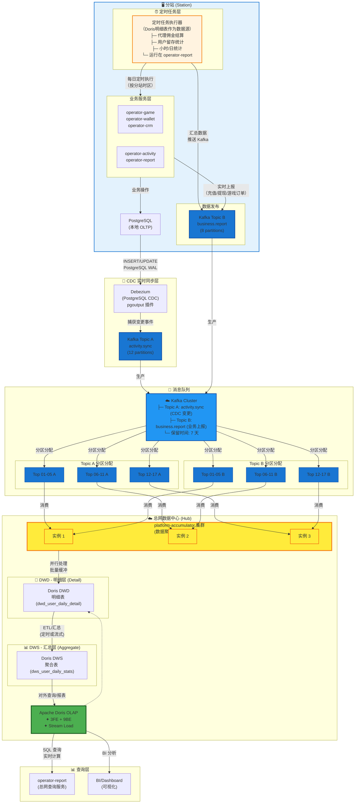

## 数据上报与存储依赖关系（分站 → 总网）

## 定时任务执行流程（以代理佣金结算为例）
```
┌─────────────────────────────────────────────────────────────┐
│ 每日 23:00:00（按分站时区）                                 │
│ operator-report (分站服务) - Cron Job                       │
└─────────────────────────────────┬───────────────────────────┘
                                  ↓
                    执行 AgentCommissionStats()
                    ├─ 查询代理信息
                    ├─ 计算本期佣金
                    ├─ 计算本期成本
                    └─ 生成结算数据
                                  ↓
                    构建 Kafka 消息（Topic B）
                    {
                      "sync_id": "sync_20240101_partner1_01",
                      "table": "t_agent_commission_report",
                      "partner_id": 1001,
                      "stat_date": "2024-01-01",
                      "data": [
                        {"agent_id": 100, "commission": 5000, ...},
                        {"agent_id": 101, "commission": 3000, ...}
                      ]
                    }
                                  ↓
                    发送到 Kafka Topic B (business.report)
                                  ↓
        ┌──────────────────────────────────────────────────┐
        │ Kafka Cluster                                    │
        │ ├─ Topic B 分区 0-7                             │
        │ └─ 消息分布: 根据 partner_id hash 分配到分区   │
        └──────────┬───────────────────────────────────────┘
                   ↓
    ┌──────────────────────────────────────────────────┐
    │ platform-accumulator 多实例消费                   │
    ├──────────────────────────────────────────────────┤
    │ ConsumerGroup: "platform-accumulator"            │
    │                                                   │
    │ ├─ 实例 1 → 消费分区 0-2                         │
    │ │   ├─ 接收 Topic A 的 CDC 变更                  │
    │ │   ├─ 接收 Topic B 的业务上报                  │
    │ │   ├─ 4层去重                                  │
    │ │   └─ 批量缓冲 → Stream Load                   │
    │ │                                               │
    │ ├─ 实例 2 → 消费分区 3-5                         │
    │ │   ├─ 接收 Topic A 的 CDC 变更                  │
    │ │   ├─ 接收 Topic B 的业务上报                  │
    │ │   ├─ 4层去重                                  │
    │ │   └─ 批量缓冲 → Stream Load                   │
    │ │                                               │
    │ └─ 实例 3 → 消费分区 6-7                         │
    │     ├─ 接收 Topic A 的 CDC 变更                  │
    │     ├─ 接收 Topic B 的业务上报                  │
    │     ├─ 4层去重                                  │
    │     └─ 批量缓冲 → Stream Load                   │
    │                                                   │
    │ 特性：                                            │
    │ • Kafka 自动分配分区给各实例                    │
    │ • 单实例宕机，其分区自动转给其他实例           │
    │ • 无需分布式锁（Kafka 消费者组保证）          │
    │ • 吞吐: 10,000+ msgs/sec                         │
    └──────────┬───────────────────────────────────────┘
               ↓
    ┌──────────────────────────────────────────────────┐
    │ Doris OLAP（实时聚合）                           │
    │ ├─ 表: t_agent_commission_detail                 │
    │ ├─ 导入方式: Stream Load                         │
    │ ├─ 吞吐: 50K rows/sec                            │
    │ ├─ 聚合类型: AGGREGATE KEY                       │
    │ └─ 延迟: <1 秒内可查询                          │
    └──────────┬───────────────────────────────────────┘
               ↓
    ┌──────────────────────────────────────────────────┐
    │ operator-report 查询服务                         │
    │ ├─ 实时查询代理累计佣金                         │
    │ ├─ 生成佣金报表（动态计算）                     │
    │ └─ 响应时间: 100-500ms                          │
    └──────────────────────────────────────────────────┘
```

## 活动中上报流程（实时 Win/Loss 数据同步）

> 基于用户在活动中的下注和输赢数据的实时上报流程，以 `dws_user_daily_stats` 表的 `win_loss` 字段为例

### 处理流程图

```
┌─────────────────────────────────────────────────────────────────┐
│                        分站 (Node-01)                           │
├─────────────────────────────────────────────────────────────────┤
│                                                                  │
│ 1️⃣  用户在活动中操作                                             │
│     └─ operator-game: InsertGameOrder()                         │
│        用户 ID: 12345                                           │
│        代理 ID: 201                                             │
│        下注金额: ¥10,000                                         │
│        赔率: 1.5                                                 │
│        结果: 赢                                                  │
│        输赢额: +¥5,000 ← win_loss                               │
│                         ↓                                       │
│ 2️⃣  计算输赢并记录统计                                           │
│     └─ operator-activity: CalculateWinLoss()                   │
│        └─ INSERT INTO t_user_daily_activity (...)              │
│           WHERE (stat_date='2024-10-13', user_id=12345, ...)   │
│           SET win_loss = win_loss + 5000                       │
│                         ↓                                       │
│ 3️⃣  PostgreSQL WAL 捕获                                          │
│     └─ WAL Logical Decoding (100ms)                            │
│        LSN: 0/3C12D50                                           │
│        Operation: INSERT/UPDATE                                 │
│        Field: win_loss = 5000                                   │
│                         ↓                                       │
└────────────────────────────────────────────────────────────────┘
                          ↓
┌────────────────────────────────────────────────────────────────┐
│               Debezium CDC 集群                                 │
├────────────────────────────────────────────────────────────────┤
│                                                                 │
│ 4️⃣  Debezium 读取 WAL                                           │
│     └─ pgoutput 插件 → 捕获变更 (CDC)                          │
│        ├─ 监听表: t_user_daily_activity                        │
│        ├─ 监听字段: stat_date, user_id, agent_id, win_loss   │
│        └─ 延迟: 100-300ms                                      │
│                         ↓                                      │
│ 5️⃣  转换为 Kafka 消息                                           │
│     └─ DebeziumChangeEvent                                     │
│        {                                                        │
│          "before": {...},                                      │
│          "after": {                                            │
│            "stat_date": "2024-10-13",                          │
│            "user_id": 12345,                                   │
│            "agent_id": 201,                                    │
│            "win_loss": 5000,      ← 关键字段                   │
│            "valid_bet": 10000,                                 │
│            "game_count": 1,                                    │
│            "updated_at": "2024-10-13 10:05:00"                │
│          },                                                     │
│          "op": "c",  // create or update                       │
│          "ts_ms": 1697155200000                                │
│        }                                                        │
│                         ↓                                      │
└────────────────────────────────────────────────────────────────┘
                          ↓
┌────────────────────────────────────────────────────────────────┐
│                    Kafka Topic A                                │
│              activity.daily_stats.sync                          │
│              (12 partitions, 3 replicas)                        │
├────────────────────────────────────────────────────────────────┤
│                                                                 │
│ 6️⃣  消息存储                                                    │
│     ├─ Topic: activity.sync                                    │
│     ├─ Partition: user_id % 12                                 │
│     ├─ Key: {syncId}                                           │
│     ├─ Value: CDC 消息 (JSON/Avro)                             │
│     ├─ 保留时间: 7天                                           │
│     └─ 吞吐: 50,000+ msgs/sec                                  │
│                         ↓                                      │
└────────────────────────────────────────────────────────────────┘
                          ↓
┌────────────────────────────────────────────────────────────────┐
│              总网 - platform-accumulator                        │
│            (数据聚合服务，3 节点高可用)                         │
├────────────────────────────────────────────────────────────────┤
│                                                                 │
│ 7️⃣  消费 Kafka 消息                                             │
│     ├─ Consumer Group: activity-daily-stats-sync-v2           │
│     ├─ ConsumerGroup Rebalancing: 自动分配分区               │
│     ├─ Lag: <1s (目标)                                        │
│     └─ 并行消费多个分区                                       │
│                         ↓                                      │
│ 8️⃣  数据规范化                                                  │
│     └─ 转换为 UnifiedMessage:                                  │
│        {                                                        │
│          "syncId": "sync_1697155200_12345_01",                │
│          "table": "t_user_daily_activity",                    │
│          "operation": "c",                                     │
│          "payload": {                                          │
│            "stat_date": "2024-10-13",                          │
│            "user_id": 12345,                                   │
│            "agent_id": 201,                                    │
│            "game_id": 101,                                     │
│            "game_count": 1,                                    │
│            "valid_bet": 10000,                                 │
│            "win_loss": 5000,      ← 数据导出                   │
│            "total_bet_orders": 1,                              │
│            "created_at": "2024-10-13 10:05:00",               │
│            "_sync_time": "2024-10-13 10:05:00"                │
│          },                                                     │
│          "dataHash": "f7a4b2c8",                               │
│          "timestamp": "2024-10-13 10:05:00"                   │
│        }                                                        │
│                         ↓                                      │
│ 9️⃣  4层去重机制                                                │
│     ├─ 层 1: Redis 快速检查 (TTL=24h)                          │
│     │   key = "sync:activity_daily_stats:{syncId}:{user_id}"  │
│     │   检查: 秒级重复                                         │
│     │                                                          │
│     ├─ 层 2: PostgreSQL 追踪表 (持久化)                        │
│     │   表: t_sync_record                                      │
│     │   查询: sync_id, table_name, data_hash                   │
│     │   检查: 分钟级重复                                       │
│     │                                                          │
│     ├─ 层 3: Doris Label 幂等性                                │
│     │   Label: "activity_daily_stats_20241013_120500_001"    │
│     │   检查: Stream Load 已提交的 label                       │
│     │                                                          │
│     └─ 层 4: Doris UNIQUE KEY 最终保障                         │
│         Key: (stat_date, user_id, agent_id)                   │
│         合并: 重复数据自动更新                                 │
│                         ↓                                      │
│🔟 缓冲与批处理                                                  │
│     ├─ 缓冲大小: 100 条记录                                    │
│     ├─ 缓冲时间: 最多 5 秒                                     │
│     ├─ 触发条件: 满足任一即 flush                             │
│     └─ 目标吞吐: 70,000+ rows/sec                            │
│                         ↓                                      │
│1️⃣1️⃣ 数据转换为 CSV 格式                                         │
│     stat_date,user_id,agent_id,game_id,game_count,           │
│     valid_bet,win_loss,total_bet_orders,_sync_time           │
│     2024-10-13,12345,201,101,1,10000,5000,1,2024-10-13 10:05:00  │
│     2024-10-13,12346,201,102,2,20000,-3000,2,2024-10-13 10:05:01 │
│     ...                                                         │
│                         ↓                                      │
│1️⃣2️⃣ Stream Load 导入                                           │
│     PUT /api/db/doris_db/dws_user_daily_stats/_stream_load   │
│     ├─ Content-Type: text/csv                                 │
│     ├─ Label: activity_daily_stats_20241013_120500_batch_001 │
│     ├─ merge_type: MERGE                                      │
│     └─ 数据验证和格式转换                                     │
│                         ↓                                      │
└────────────────────────────────────────────────────────────────┘
                          ↓
┌────────────────────────────────────────────────────────────────┐
│                  Doris OLAP 存储层                              │
│         表: doris_db.dws_user_daily_stats                      │
│         分布: 3FE + 9BE                                        │
├────────────────────────────────────────────────────────────────┤
│                                                                 │
│1️⃣3️⃣ Doris 处理流程                                             │
│     ├─ 验证权限和 label (幂等性检查)                          │
│     ├─ 解析 CSV 数据                                           │
│     ├─ 按分区分布:                                             │
│     │   分区: stat_date = 2024-10-13                          │
│     │   分桶: user_id % 64                                    │
│     │   副本: 2 份                                             │
│     ├─ 数据合并 (MERGE 模式):                                 │
│     │   UNIQUE KEY: (stat_date, user_id, agent_id)           │
│     │   ├─ 若存在则 UPDATE                                   │
│     │   └─ 若不存在则 INSERT                                 │
│     └─ 延迟: 300-500ms (从 PUT 到可查询)                      │
│                         ↓                                      │
│1️⃣4️⃣ Doris 返回导入结果                                         │
│     {                                                          │
│       "Status": "Success",                                     │
│       "NumberRows": 100,                                       │
│       "NumberLoadedRows": 100,                                 │
│       "LoadTimeMs": 420                                        │
│     }                                                          │
│                         ↓                                      │
└────────────────────────────────────────────────────────────────┘
                          ↓
┌────────────────────────────────────────────────────────────────┐
│                    查询与可视化                                  │
├────────────────────────────────────────────────────────────────┤
│                                                                 │
│1️⃣5️⃣ 实时数据可查询                                             │
│     └─ operator-report 查询服务                               │
│        ├─ SQL: SELECT SUM(win_loss)                           │
│        │        FROM dws_user_daily_stats                     │
│        │        WHERE stat_date = '2024-10-13'               │
│        │        GROUP BY agent_id                             │
│        ├─ 响应时间: 100-500ms                                │
│        └─ 结果: 代理日均输赢统计                             │
│                         ↓                                      │
│1️⃣6️⃣ BI 仪表盘展示                                              │
│     ├─ 实时显示各分站 win_loss 排行                           │
│     ├─ 动态数据刷新                                           │
│     └─ 支持多维度分析 (代理/游戏/时段)                       │
│                                                                 │
└────────────────────────────────────────────────────────────────┘
```

### 关键数据字段映射

| 来源 | 字段 | Kafka | Accumulator | Doris |
|-----|------|-------|------------|-------|
| operator-game | 用户 ID | `user_id` | `user_id` | `user_id` |
| operator-activity | 代理 ID | `agent_id` | `agent_id` | `agent_id` |
| operator-activity | 下注金额 | `valid_bet` | `valid_bet` | `valid_bet` |
| operator-activity | **输赢金额** | `win_loss` | `win_loss` | `win_loss` ⭐ |
| operator-activity | 统计日期 | `stat_date` | `stat_date` | `stat_date` |
| operator-activity | 更新时间 | `updated_at` | `_sync_time` | `_sync_time` |

### 完整时间线

```
Timeline (用户下注到数据可查询):
  T0 (10:05:00)      - 用户在活动中下注，输赢 +¥5,000
  T0+10ms            - operator-activity 写入 PostgreSQL
  T0+100ms           - PostgreSQL WAL 捕获 (Logical Decoding)
  T0+200ms           - Debezium 解析并发送到 Kafka Topic A
  T0+250ms           - 消息在 Kafka 中（分区 0）
  T0+300ms           - platform-accumulator 消费消息
  T0+350ms           - 4层去重检查完成
  T0+400ms           - 数据加入缓冲区
  T0+5s              - 缓冲条件触发（5秒或100条消息）
  T0+5.5s            - Stream Load 开始导入 Doris
  T0+5.8s            - Doris 处理完毕（300-500ms）
  T0+5.9s            - 数据在 Doris 中可查询

总延迟: ~5.9 秒 (从用户下注到总网可查询)
```

### 性能指标

| 指标 | 目标 | 说明 |
|-----|-----|------|
| CDC 延迟 | <500ms | PostgreSQL WAL 到 Kafka |
| Kafka 吞吐 | 50,000+ msg/s | 分站到总网消息队列 |
| Accumulator 延迟 | <1s | 消费到 Stream Load 发起 |
| Stream Load 吞吐 | 70,000+ rows/sec | Doris 导入速率 |
| Doris 导入延迟 | 300-500ms | HTTP 响应时间 |
| 查询延迟 (p99) | <500ms | SQL 查询响应时间 |
| **端到端延迟** | **<6s** | 从下注到数据可查 |

### 故障恢复机制

| 故障场景 | 影响 | 恢复时间 | 数据保证 |
|---------|------|--------|--------|
| PostgreSQL 宕机 | 新数据无法产生 | 1-2 分钟 (HA 切换) | 历史数据完整 |
| Kafka Broker 故障 | 消费中断 | 30-60 秒 (自动选主) | Offset 自动恢复 |
| Doris 磁盘满 | 导入失败 | 5-10 分钟 (清理) | 缓冲数据重试 |
| 网络分区 | 数据不同步 | 1-2 分钟 (恢复) | WAL 日志保留 |
| Accumulator 实例宕机 | 该实例消费的分区短暂停止 | <30 秒 (重新分配) | Kafka 消费者组自动转移 |

### 双通道架构（活动+业务数据并行）

platform-accumulator 支持并行消费两个 Kafka Topic：

- **Topic A (activity.sync)**: Debezium CDC 变更（100ms 延迟，准确可靠）
- **Topic B (business.report)**: 业务系统直接上报（实时补全）

```
优先级处理: CDC (优先级=100) > Business (优先级=50)

若两个通道同时上报同一用户同一天的数据：
  1. 比较优先级
  2. 保留优先级高的数据
  3. 记录血缘信息
  4. 支持可审计追溯
```